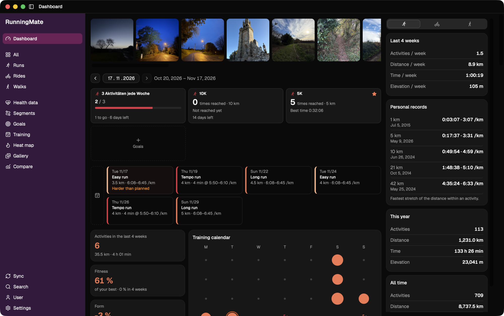

# RunningMate


RunningMate is a desktop app to store, analyse and visualise your running, cycling and walking
activities. It's built with [Rust](https://www.rust-lang.org) and [Tauri](https://tauri.app), with
a React interface using [shadcn/ui](https://ui.shadcn.com).

The app does not store any of your data outside your computer. Everything lives in the
`RunningData` folder in your home directory: a [SQLite](https://www.sqlite.org/) database, the
archived activity files (`imports`) and your photos and videos (`media`).



## Documentation
The documentation can be found [here](https://axelmichel.github.io/runningmate).

## Features
- **Sync** activities in from TCX and GPX files, a watched folder (e.g. an iCloud export of RunGap
  or HealthFit) or **Garmin Connect**. Garmin works both ways: new Garmin activities are imported,
  activities recorded elsewhere can be uploaded. Duplicates are recognised; files without GPS wait
  for their route to be drawn.
- A **dashboard** with your latest photos, the last four weeks, goals, the training week, a volume
  chart, an activity feed and personal records; it can look back in time.
- Activity lists per sport with search (by title, comment, place or distance like `>21` or `10km`),
  filters and a heatmap of training time over the last year; a panel with the key figures, whose
  boxes you choose per sport. Places are named from OpenStreetMap (can be switched off).
- A **detail view** per activity: route, pace and heart-rate maps, elevation, heart-rate, speed and
  steps charts, grade-adjusted pace (GAP) for runs and walks, splits, best segments, heart-rate zones, EPOC-based aerobic and anaerobic training effect beside
  the 1–12 effect score, weather from
  [Open-Meteo](https://open-meteo.com) and an optional **AI summary** written by a local
  [Ollama](https://ollama.com) model (nothing leaves your computer).
- **Fix data**: GPS spikes and dropouts redrawn on the map (optionally along OpenStreetMap paths),
  heart rate and steps corrected per stretch or per split, with missing and implausible values
  found for you and a missing stretch estimated from your pace; the original file is kept.
- **Segments**: mark a stretch once, and every pass over it in past and new activities is ranked.
- **Goals** for distance, time, climb or number of activities, once or repeating, and **training
  plans** for a race or for fitness, built from your recent runs.
- **Health data**: fitness, fatigue and form, a cardio-fitness (VO2max) estimate, heart rate and
  time in zones over a period.
- A **heat map** of all GPS tracks and a **gallery** of all photos and videos.
- **Compare** up to ten activities in charts: key figures, pace and heart rate over distance, a
  virtual race, splits, training effect and zones, also limited to the passes of a segment.
- **Social share**: an image of an activity for Instagram, stories, X or Facebook, with the route
  and the figures placed freely.
- Photos and videos per activity, picked from the Photos library on macOS, dropped onto the app or
  linked from disk; copied photos are scaled down to a size you choose to save space.
- English and German.

## Installation
Download the latest release from the
[releases page](https://github.com/axelmichel/runningmate/releases) and open the installer for your
system (on macOS the `.dmg`). The app isn't code-signed yet, so macOS asks for confirmation the
first time you open it.

## Development
Prerequisites: [Rust](https://rustup.rs) (stable), [Node.js](https://nodejs.org) 22 with pnpm 9,
and the [Tauri prerequisites](https://tauri.app/start/prerequisites/) for your system.

```sh
cd app
pnpm install
pnpm tauri dev     # run the app in development mode
pnpm tauri build   # build the installer
```

To work against a copy of your data, point the app at another folder:
`RUNNINGMATE_DATA_DIR=/path/to/copy pnpm tauri dev`. For screenshots, `VITE_PRIVACY=1 pnpm tauri dev`
blurs activity titles, comments and segment names (development builds only).

### Checks
All pull requests run these:

```sh
cd app
pnpm typecheck && pnpm lint && pnpm format:check && pnpm test
cd src-tauri
cargo fmt --check && cargo clippy --all-targets -- -D warnings && cargo test
```

See [`app/README.md`](app/README.md) for the layout of the code.

### Documentation
The documentation is written in Markdown in the `docs` folder and built with
[MkDocs](https://www.mkdocs.org/) (`pip install mkdocs mkdocs-material`, then `mkdocs serve`).
Changes on `main` are published to GitHub Pages automatically.

## Contributing
Feel free to contribute by submitting issues or pull requests on GitHub. Please follow the existing
style and include documentation for new features.
