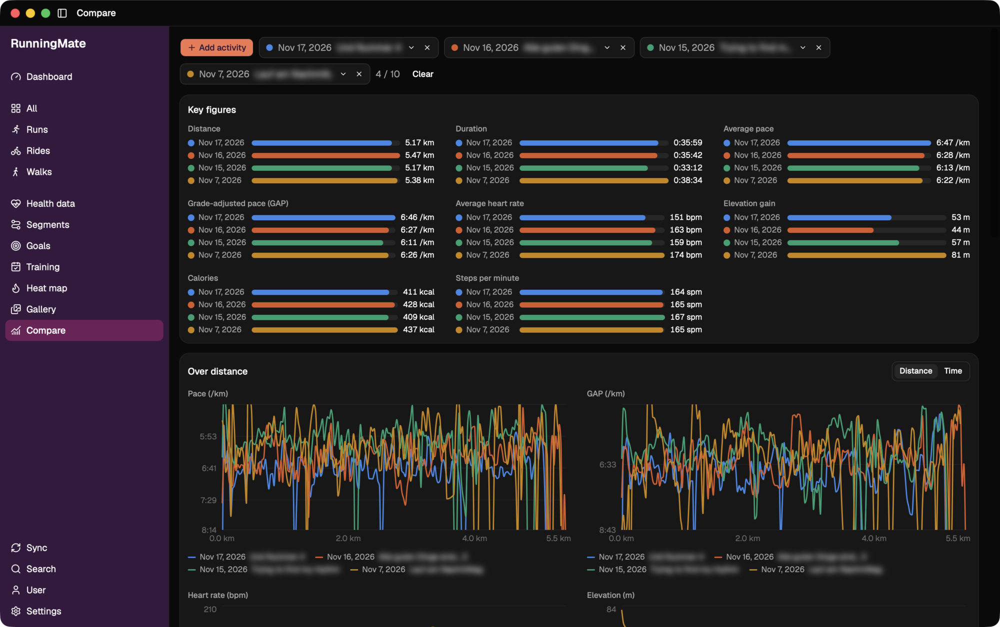

# Compare

The Compare page puts up to ten activities side by side in charts, of one sport or mixed.

## Choosing activities
Open it from the sidebar or with ⇧⌘C. **Add activity** opens a list of all activities, newest first, with the same
search as the activity list: words from the title, comment or place name, and distances such as `10km` (±5 %), `>21`,
`<5` or `5-10km`. The buttons below the search show one sport only. Click a row to add it, click it again to take it
out.

Each activity gets a colour, which it keeps while others are added or removed; the same colour marks it in every chart.
The chips at the top show its date and title: click one to open the activity in the [detail window](detail-window.md),
the cross removes it and **Clear** removes all. The selection is kept until you change it.

The arrow on a chip opens more ways to fill the page from that activity:

- **Add similar activities** adds activities of the same sport that start within 200 m of it and are within 5 % of its
  distance, newest first, until there are ten. The start is the point where the place name was looked up, or else the
  first position of the track; activities without GPS have none.
- **Fastest passes of a segment** and **Latest passes of a segment** list the [segments](segments.md) the activity
  passes. Choosing one replaces the selection with the activity and the activities of the fastest (or most recent)
  other passes, one pass per activity, ten at most. The segment window has a **Compare** button that does the same
  with the fastest passes.

## Segment passes
When the page shows the passes of a segment, its name appears above the charts, and **Only the segment** (on by
default) limits the key figures, the charts over distance or time and the virtual race to the stretch of each
activity that passes the segment, counted from the segment's start. On the segment the key figures are measured on
the track, so there are no calories. Splits, training effect and heart-rate zones are always those of the whole
activities. Adding an activity that doesn't pass the segment turns the page back into a plain comparison.

## What is compared

- **Key figures**: distance, duration, average pace (speed for rides), grade-adjusted pace, heart rate, elevation gain,
  calories and steps per minute, one bar per activity. A figure that none of the activities has is left out.
- **Over distance**: pace (or speed), grade-adjusted pace, heart rate, elevation and steps per minute, one line per
  activity. **Time** switches the axis to the time since the start. Lines are averaged over short stretches so the
  tracks can share one axis.
- **Virtual race**: how far each activity is behind (+) or ahead (−) of the fastest at every point, over the distance
  all of them cover. The fastest is the one first at the end of that distance; its line stays at zero. The times
  include pauses.
- **Splits**: the pace (or speed) of each kilometre, or of each 5 km for rides. Rides and runs or walks together
  aren't compared here, since their splits differ.
- **Training effect**: aerobic and anaerobic training effect, peak EPOC, recovery time and the effect score (see
  [Trainings effect](../metrics/trainings-effect.md)). Activities without a heart rate have no training effect.
- **Time in heart-rate zones**: one bar per activity, split into the five zones.

Grade-adjusted pace and steps are only shown for runs and walks. As soon as a ride is among the activities, pace is
shown as speed (km/h) for all of them, so they share one axis; a note above the charts says so.

Below each chart the legend shows which colour is which activity; click an entry to open it. Hover over a chart to see
the values of all activities at that point.
