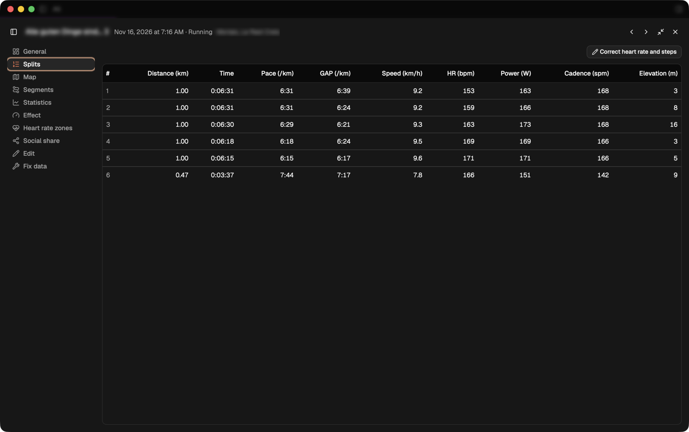

# Detail Window

The detail window shows everything about one activity. Open it by double-clicking an activity in the list, with
**View details** in the activity's **⋮** menu, with **Open details** in the activity panel, or by clicking an activity on
the dashboard, in the gallery, on the goals or training pages or in a segment's ranking.

It opens on **General**. An activity you haven't reviewed yet (no edit, comment, photo or video) opens on **Edit**
instead, so you can give it a title and a comment right away. The page you pick stays selected when you move to another
activity.

The header shows the title, date and type, and these buttons:

- **Toggle navigation** shows or hides the page names on the left; hidden, only their icons remain. The choice is kept.
- **Previous activity** and **Next activity** move through the activities in the order of the list you opened the
  window from (only when you opened it from a list).
- **Maximize** fills the app window; **Restore size** makes it smaller again. The choice is kept.
- **Close** closes the window.

If a page has changes you haven't saved (the **Edit** page, split corrections or fixes on **Fix data**) and you leave
it, move to another activity or close the window, the app asks **Save your changes?**: **Save** saves them and goes on,
**Discard** drops them, **Cancel** stays.

## General
On the left is the same panel as beside the activity list: duration, pace (for runs and walks also the
[grade-adjusted pace](../metrics/pace.md#grade-adjusted-pace-gap)), the route, distance and elevation, the
Garmin Connect link, goals, training session and trophies, the weather and the best segments. Which boxes it shows is
set per sport in the settings under **Activity panel**.

On the right you'll find:

- **Summary**, a short text comparing the activity with similar and recent ones, written by a local AI model. It only
  shows when AI summaries are turned on in the settings under **AI summary**. Click **Write summary** (or **Rewrite**)
  to have it written; this takes a moment. The note below it names the model.
- **Photos and videos** of the activity (see [Photos and videos](#photos-and-videos) below).
- Your comment.
- Further figures, where available: calories, average heart rate, average power, average speed, fastest and slowest
  pace, cadence and steps (not for rides), pause time, and the shoes or bike.

### Photos and videos
Add photos and videos with the buttons above the gallery:

- **From this activity…** (macOS) opens **Photos from this activity**: the photos and videos in your Photos library taken
  during the activity (from 10 minutes before the start to 10 minutes after the end). Tick the ones you want, or use
  **Select all**, and click **Add**. Items already added are marked. The first time, the app asks for access to your
  Photos library (**Allow access…**); nothing in it is changed or uploaded. If access was denied, **Open System
  Settings** takes you to the place to allow it.
- **From Photos…** (macOS) opens the system photo picker, to pick any photo or video.
- **From files…** picks files from disk (PNG, JPG, HEIC, MP4, MOV, AVI). You can also drop files from Finder onto the
  gallery.

Photos from the Photos library are always copied. For files from disk the app asks whether to **Copy into RunningMate**
(the file is safe in the app's media folder) or **Link to originals** (saves space, but breaks if the original is moved
or deleted). Tick **Remember my choice** to stop being asked; you can change it in the settings under **General**
(**Adding photos and videos from files**). Linked files show a small link symbol; a file that can no longer be found
shows **File missing**.

Click a photo or video to see it in full. Move with the arrows on screen or the arrow keys, or click a thumbnail in the
strip below. **Slideshow** shows each photo for a few seconds and plays videos to their end; the space bar starts and
stops it. To remove a file, hover over it and click **×**: a copied file is deleted from the media folder, for a linked
one only the link is removed.

## Splits
This page lists the splits of the activity: one per kilometre, or per 5 kilometres for rides. For each split you'll see
the distance, time, pace, **GAP** (the [grade-adjusted pace](../metrics/pace.md#gap-of-a-split), not for rides),
speed, heart rate, power, cadence (not for rides) and elevation gain, where recorded.

Click **Correct heart rate and steps** (only **Correct heart rate** for rides) to type in the average heart rate or steps
per minute a split should have. On **Save and recompute**, the recorded values of that split are shifted so its average
matches, and the activity is recomputed: the charts, zones, training effect and the other splits follow. The change is
written into the stored activity file, so it also holds when the activity is processed again. **Reset to original** on
the **Fix data** page undoes it.

## Map
The map shows the track of the activity, with a light or dark map following the app's appearance. A dot marks the
start and another the finish.

The buttons above the map:

- **Track**, **Pace** and **Heart rate** colour the track: in one colour, or from slow to fast or low to high heart
  rate, with a scale beside the buttons. Pace and heart rate are only available when they were recorded.
- **Km markers** (**5 km markers** for rides) shows or hides numbered markers at each kilometre.
- **Splits** shows or hides a list of the splits beside the map, with time and speed; click one to put a position dot
  where it ends (the map moves there if needed, and the charts mark it).
- **Charts** shows elevation, heart rate, speed and, for runs with cadence data, steps per minute over the distance below
  the map (hidden at first). For runs and walks the speed chart has the grade-adjusted speed as a second, dashed
  line. Moving the mouse over them moves the position dot along the track.

The app remembers which of these you turned on.

## Segments
Lists the [segments](segments.md) this activity passes, each with its distance, grade and climb, the time, pace (speed
for rides) and its place among all tries, e.g. "2 of 7". A gold, silver or bronze trophy marks the three fastest places.
Click a segment to highlight it on the map, or click **Open segment** to see its full ranking, where this activity's
passes are marked.

Arrows along the track show the direction you went, and the numbered markers the kilometres (5 km for rides), so you can
tell whether a stretch went up or down. Click **New segment** to mark one: click on the track where it starts, then where
it ends. Where the track passes the same spot more than once, the start is the first pass and the end the next pass after
the start. Use the slider to fine-tune both ends, check distance, average grade, elevation gain and the elevation
profile, give it a title and click **Save segment**. A segment must be at least 100 m long. **Stop marking** or
**Cancel** leaves without saving. The app then looks for passes over the new segment in all your activities of the same
sport, in the background.

## Statistics
Charts over the distance of the activity: **Elevation**, **Heart rate**, **Pace** (faster at the top; for runs and
walks with the [grade-adjusted pace](../metrics/pace.md#grade-adjusted-pace-gap) as a dashed line) and, for runs,
**Steps per minute**. A chart only shows when its values were recorded. Hover over a chart to read the value at a point.
See [Pace](../metrics/pace.md) and [Activity data](../metrics/activity-data.md) for how the values are worked out.

## Effect
- **Training effect** shows the **aerobic** and the **anaerobic** training effect of the activity, each from 0.0 to
  5.0 on a scale of five steps with its meaning (from "No effect" to "Overreaching"), the **peak EPOC** in ml/kg and
  the **recovery time**. Below, it lists the maximum and resting heart rate and the VO2max it was rated with and where
  they come from, e.g. "estimated as 220 − age" when your profile has no maximum heart rate. Activities without heart
  rate have no training effect. See [Trainings Effect](../metrics/trainings-effect.md) for how it is calculated.
- **Heart rate by zone** (runs and rides with heart-rate data) shows the heart rate over the time of the activity, the
  line coloured by your heart-rate zones over light bands for each zone. The zones are set in the
  [user settings](user-settings.md).
- **Fitness trend (90 days)** shows fitness, fatigue and form over the 90 days up to the activity. See
  [Fitness](../metrics/fitness.md).

## Heart rate zones
**Time in heart-rate zones** shows, for each zone with its heart-rate range, the share and the time you spent in it
during the activity. You set the zones in the [user settings](user-settings.md); without them this box asks you to.
See [Heart rate zones](../metrics/heart-rate-zones.md) for how they work.

**Heart-rate trend (90 days, same activity type)** plots the average heart rate of each activity of the same type over
the 90 days up to this one, with a trend line, and dashed lines at the upper bounds of zones 1, 3 and 5 (**Min**,
**Ideal**, **Max**).

## Social share
Builds an image of the activity for social media. Pick a size: presets for an Instagram post (1:1) or portrait (4:5),
a story (9:16), an X post (16:9) and a Facebook post, or any size of your own. Then pick a background: a gradient, a
single colour, one of the activity's photos (or any image file), a light or dark map, or transparent. Photos and the
map can be darkened so the text stays readable. Choose which facts to show (title, date, distance, duration, pace or
speed, elevation, heart rate, calories) and the colours and sizes of the route and the text.

Each fact is its own element: the route, the title, the date and every figure can be placed anywhere. Click an
element to select it, Shift-click to add more; drag to move the selection, or nudge it with the arrow keys (Shift for
bigger steps). On a map, the map moves with the route, so it stays on its streets. The bar above the preview lines up
the selection: one element (or group) on the image's left edge, centre or right edge, top, middle or bottom; several
on each other. **Equal space** spreads three or more evenly between the outer two, or one or two evenly across the
image. **Group** keeps elements together: clicking one selects the whole group, and it moves, lines up and spreads as
one. Turn on **Grid** to see a grid over the preview (not in the image): dragged elements put their nearest edge or
centre on its lines; hold Option (⌥) while dragging to place them freely. **Reset positions** puts everything back.

**Save image…** writes a PNG; **Share…** opens the macOS share menu (Messages, Mail, AirDrop, Photos and any
app that offers itself there). To post on Instagram, save the image and upload it from your phone or the website.
The editor remembers your last settings for the next activity.

## Edit
Change the **Title**, the **Comment**, the **Type** (e.g. **Trail**, **Interval** or **Long Run** for runs, **Hiking** for walks, **Gravel Biking** for
rides), the **Start** time, the **Duration (h:mm:ss)**, the **Distance (km)** and the **Elevation (m)**, and click
**Save**. The window then goes back to **General**. Changing distance, duration or elevation here doesn't change the
recorded track, so the splits, charts and segment times stay as they were; to correct the track itself, use
**Fix data**.

Beside the form, pick the **Shoes** (or **Bike** for rides) you used, or **None**. This applies right away and moves
the distance from one item to the other. Retired items are only listed while they are assigned to this activity.

Below the form you can add and remove photos and videos, as on the [General](#photos-and-videos) page; these changes
apply right away.

To process an activity again from its file or to delete it, use **Re-import from TCX** or **Delete…** in the activity's
**⋮** menu in the [activity list](main-window.md).

## Fix data
Corrects recording errors in the activity's track. Choose what to fix at the top: **Route**, **Heart rate** or
**Steps** (not for rides). Fixes collect in the **Fixes** list, where you can remove them again; **Recorded** and
**After the fixes** compare the distance (or the average heart rate or steps) before and after. **Save and recompute**
writes the fixes into the stored activity file and recomputes the activity: distance, splits, charts, zones, training
effect, segments and goals follow. The original file is kept, so **Reset to original** drops all fixes of route,
heart rate and steps (and split corrections) and recomputes the activity from the file as it was imported.

### Route
The map shows the track; **Problems found** lists **GPS spike** (positions far off the route, faster than the sport
allows) and **GPS dropout** (stretches without a position, or a long jump in time and place), marked red on the map.

- Drag the track to move it: the stretch around the point you grab (about 250 m either side) follows.
- Click a problem, or **Pick a stretch on the map** and click where the stretch starts and where it ends. Then click the
  map to draw the route of that stretch; drag the points to move them, **Undo point** takes the last one back. The
  stretch's time span and the new length are shown. **Use route** adds it to the fixes, **Cancel** drops it.

With **Follow paths** turned on, the drawn route follows OpenStreetMap paths between your points instead of straight
lines. This sends the points you place to routing.openstreetmap.de; turn it off to keep everything on your computer. If
no path can be found, straight lines are used.

An activity recorded without GPS (**No GPS**) starts with drawing the whole route.

### Heart rate and steps
A chart shows the recorded values (heart rate in bpm, or steps per minute) over the distance, with your changes on top.
**Problems found** lists stretches that look wrong: a **Spike**, a **Dropout**, an **Implausible start** (a heart-rate
strap settling in during the first minutes) or, for heart rate, **Reads the steps** (the strap picked up the step rate
instead of the heart rate).

Click a problem or drag over the chart to select a stretch; you can fine-tune it in the **From (km)** and **To (km)**
fields, and its average is shown. Then:

- **Interpolate** replaces the values with a straight line between the values before and after the stretch,
- **Set** sets them all to the value you type in,
- **Shift** moves them up or down by the value you type in.

To correct the average of whole splits instead, use **Correct heart rate and steps** on the [Splits](#splits) page.
