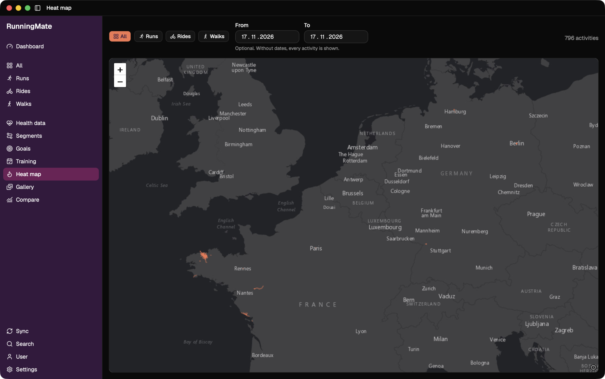

# Heat Map

The heat map draws the GPS track of every activity on one map. Each track is a thin, see-through line, so roads and
trails you use often add up to a brighter line, and places you went to only once stay faint.

## The Heat Map page

Open it from the sidebar or with ⇧⌘M. At first it shows all activities of all sports. Filter by sport at the top, and
limit the period with **From** and **To**; **Any time** clears the dates again. The map zooms to the tracks of the
selection and the number of activities shown is at the top right. Activities without a GPS track, such as treadmill
runs, are left out.

## How the tracks are kept
For the heat map, each track is simplified once (points that lie within about 5 m of the line are dropped) and stored
with the activity. New activities get their track when they are imported. Activities imported before the heat map
existed get it the first time they are shown, which can take a moment with many activities. After that, opening the
page or changing the filters only reads the stored tracks. Re-importing an activity or fixing its route in the
detail window stores its track again. Deleting an activity removes its track as well.
