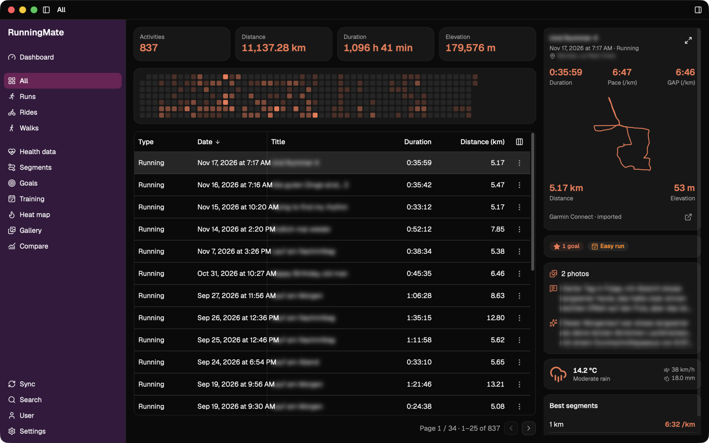
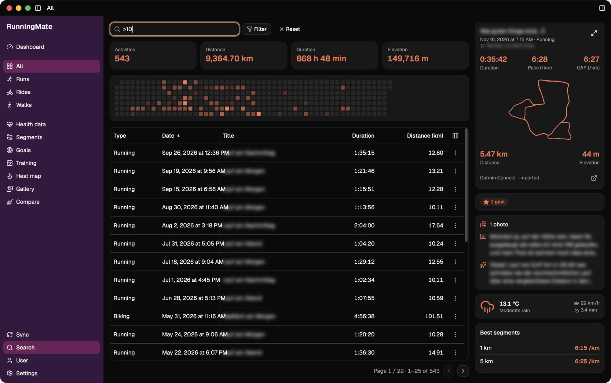

# Main Window

The main window has a title bar at the top, the sidebar on the left and the current page beside it. On the activity
pages a details panel on the right shows one activity.

## Title bar
The title bar shows the name of the current page. The button on the left collapses the sidebar to its icons and opens
it again (also ⌘B). On the activity pages, the button on the right (**Toggle details panel**) shows or hides the details
panel; the choice is kept.

## Sidebar
The sidebar has three groups of pages. Hover an entry to see its shortcut; the same pages are in the **View** menu.

| Entry | Shortcut | Page |
|---|---|---|
| **Dashboard** | ⇧⌘D | The start page, see [Dashboard](dashboard.md) |
| **All**, **Runs**, **Rides**, **Walks** | | The activities of all sports or of one sport (below) |
| **Health data** | ⇧⌘H | Fitness, form and heart rate, see [Health data](health.md) |
| **Segments** | ⇧⌘G | See [Segments](segments.md) |
| **Goals** | ⇧⌘O | See [Goals](goals.md) |
| **Training** | ⇧⌘T | See [Training](training.md) |
| **Heat map** | ⇧⌘M | See [Heat map](heat-map.md) |
| **Gallery** | ⇧⌘P | See [Gallery](gallery.md) |

At the bottom:

- **Sync** (⌘O) imports activities from files, a folder or Garmin Connect, see [Sync](sync.md).
- **Search** (⌘F) opens the activities with the search bar, see [Search and filters](#search-and-filters).
- **User** opens your profile, shoes, bikes and heart-rate zones, see [User settings](user-settings.md).
- **Settings** (⌘,) opens the app settings, see [Settings](settings.md).

The app opens on the dashboard.

## Activities
**All**, **Runs**, **Rides** and **Walks** show the activities of that sport. Switching sport keeps a search or filter,
but goes back to the first page and to sorting by date.

### Info cards and training calendar
At the top, four cards add up the activities shown: **Activities**, **Distance**, **Duration** and **Elevation**.

Below them is a calendar of the last 52 weeks, one square per day and one column per week (Monday at the top). The more
time you trained that day, the stronger the colour, measured against the busiest day in the calendar. Hover a square to
see the date and the training time. With a date filter, the calendar ends on the **To** date (or a year after the
**From** date).

Both follow the sport and any search or filter.

### The table
The columns depend on the sport:

- **All**: **Type**, **Date**, **Title**, **Duration**, **Distance (km)**.
- **Runs**: **Date**, **Title**, **Duration**, **Distance (km)**, **Elevation (m)**, **Speed (km/h)**, **Pace (/km)**,
  **HR (bpm)**, **Steps**, **Pause**.
- **Rides**: as runs, with **Power (W)** instead of **Steps**.
- **Walks**: as runs, without **Pause**.

The button at the right end of the header row (**Columns**) adds optional columns: **Location**, the place the activity
started in (see [Settings](settings.md)), shown after the title. The choice is kept.

Click a column header to sort by it, and again to reverse the order; an arrow marks the sorted column. The first two
columns stay in place when you scroll the table sideways. The table shows 25 activities a page; the arrows below it move
between pages.

- **Click** a row to show the activity in the details panel.
- **Double-click** a row to open it in the [detail window](detail-window.md). Previous and next in the detail window
  follow the order of the table, across pages.
- The **⋮** button at the end of a row opens a menu:
    - **View details** opens the detail window.
    - **Re-import from TCX** processes the stored activity file again, for example after an update of RunningMate
      changed how something is calculated.
    - **Upload to Garmin Connect** uploads the activity (sign in under [Sync](sync.md) first).
    - **Delete…** deletes the activity, see [Deleting](#deleting).

## Search and filters

Click **Search** in the sidebar, choose **View → Search** or press ⌘F to show the search bar above the activities; the
same again hides it. Type to search: the list updates after a short pause. The search ignores upper and lower case and
looks in the title, the comment and the place the activity started in. With several words, every word has to appear,
each in any of them and in any order: `Freiburg morning` finds the morning runs from Freiburg. Escape closes the search
bar.

Distances can be typed into the search box too (in km, with `.` or `,` for decimals); the other words are still searched
for:

| Type | Finds activities of |
|---|---|
| `10km` or `10 km` | about 10 km (±5 %) |
| `>21` or `>=21` | at least 21 km |
| `<5km` or `<=5` | at most 5 km |
| `10-15km` | 10 to 15 km |

A number without `km` or `<`/`>` (like `2024`) is searched for as text. Together with a distance range from **Filter**,
both apply: `<15km` with a filter from 5 to 20 km shows 5 to 15 km.

**Filter** opens a dialog with ranges for **Date**, **Distance** (km), **Duration** (min) and **Elevation** (m), each
with **From** and **To**. Leave a field empty to not filter by it. Both ends are included; a **To** below its **From**
is raised to the **From**. **Apply** sets the filter. The active filters show as small labels next to the search box,
and **Reset** clears the search text and all filters.

The info cards, the training calendar and the table all follow the search and the filters.

## Details panel
The details panel shows the activity you clicked, or else the latest activity of the sport shown. From top to bottom:

- **Overview**: title, date and time, the type, the place it started in (once looked up), **Duration**, **Pace (/km)**, for runs and walks **GAP (/km)** (the
  [grade-adjusted pace](../metrics/pace.md#grade-adjusted-pace-gap)), the route map, **Distance** and
  **Elevation**. The button at the top right opens the [detail window](detail-window.md). Hover the route to get a
  button that saves it as an image (PNG or SVG, white lines on a transparent background). If the activity came from or
  went to Garmin Connect, a line says so, with a button that opens it there.
- **Goals, sessions and trophies**: a star with the number of [goals](goals.md) the activity hit, the kind of
  [training](training.md) session it did, and a trophy with the number of [segments](segments.md) where it is in the
  top 3. Hover them for the details. The box is left out when there is none of them.
- **Photos, comment and summary**: the number of photos and the start of the comment and the AI summary. Click it to
  open the detail window, where they are in full.
- **Weather**: the conditions, the average temperature, the strongest wind and the rain.
- **Best segments**: the fastest pace over set distances within the activity (1, 5, 10, 21 and 42 km for runs; 5 to
  200 km for rides; 1 to 50 km for walks).

Which boxes are shown can be chosen separately for runs, rides and walks in [Settings](settings.md) on the
**Activity panel** page: **Route map**, **Garmin Connect link**, **Goals, sessions and trophies**,
**Photos, comment and summary**, **Weather** and **Best segments**. The same choice applies to the overview in the detail
window (except photos, comment and summary, which only show in the details panel). Other activity types show every box.

## Deleting
Choose **Delete…** in a row's **⋮** menu and confirm. The activity is removed with everything that belongs to it: its
archived file (and the original kept by a fix), splits, weather, best performances, segment passes, heat-map track, AI
summary and Garmin link, and the photos and videos copied into RunningMate. Linked photos and videos stay where they
are; only the link to them is removed. Goals and the distance of its shoe or bike are updated, and a training session it
was linked to stays in the plan, unlinked. Segments drawn on the activity are kept. Deleting can't be undone.
