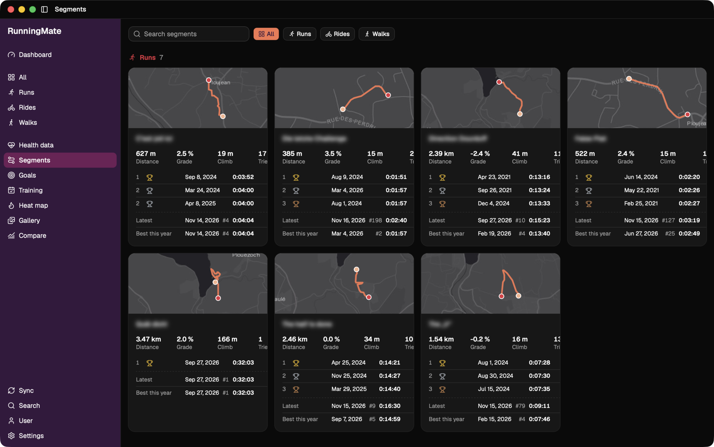

# Segments

A segment is a stretch of road or trail you want to compare yourself on, for example a hill you run up every week.
You mark segments on the map of an activity and the app finds every time you passed over them: in all activities
already imported and in every activity imported later, for the same sport.

## Creating a segment
Open an activity, go to its **Segments** page in the [detail window](detail-window.md#segments) and click
**New segment**. Click on the track where the segment starts, then where it ends; arrows along the track show the
direction you went. Where the track passes the same spot more than once, the start is the first pass and the end the
next pass after the start. Use the slider to fine-tune both ends, check distance, average grade, elevation gain and the
elevation profile, give the segment a title and click **Save segment**. A segment must be at least 100 m long.

The app then looks for passes over the new segment in all your activities of the same sport, in the background.

## How a pass is found
An activity counts as a try when its track

- comes within about 35 m of the segment's start and, later, of its end,
- covers between 80 % and 125 % of the segment's length in between, and
- stays within about 50 m of the segment all the way.

Passing in the opposite direction, taking a parallel road or a shortcut doesn't count. If you pass a segment several times
in one activity (laps), every pass is a try of its own. Passes across a clock running backwards and impossible paces
(faster than the per-point limit of the sport) are left out, as for the best segments.

The time of a pass is measured between the points closest to the segment's start and end. Recording pauses on the
segment count towards the time.

Passes are looked for again whenever an activity is imported, re-imported or its route is fixed on the
[Fix data](detail-window.md#fix-data) page.

## The Segments page

Open it from the sidebar or with ⇧⌘G. Segments are shown as cards, grouped by sport, each with a small map, the
distance, average grade, climb and number of tries. Below these, the card lists the three fastest passes, your
latest pass and your fastest pass this year (**Best this year**), each with its time and place overall.

Search by title with **Search segments**, and show only one sport with the buttons beside it.

## A segment
Click a card to open the segment. The header shows the title, the sport and when the segment was created.

**Overview** shows a map, the elevation profile with the grade, and the distance, average and steepest grade (**Max
grade**, measured over 100 m so GPS noise doesn't make spikes), elevation gain, the lowest and highest point and the
number of tries (with the number of activities, if you passed more than once in one). Below are the same highlights as
on the card, and the full ranking: every pass, fastest first, with date, activity, time, pace (speed for rides) and
heart rate, 20 per page.

**Progress** charts every pass by date with its time: the three fastest in gold, silver and bronze, the latest
outlined, and the best time as a dashed line. Hover over a point to see its place.

On the Segments page, click a row of the ranking, a highlight or a point of the chart to open that activity. When you
open a segment from an activity's **Segments** page, that activity's passes are marked in the ranking, which opens on
the page of its first pass.

**Compare** opens the [Compare page](compare.md) with the activities of the fastest passes (one per activity, ten at
most), limited to the segment's stretch of each.

Click the pencil beside the title to rename the segment. **Delete segment** removes the segment and its ranking; the
activities stay as they are.

## Trophies
An activity that is among the three fastest passes on a segment shows a trophy with the number of such segments, on the
dashboard feed and in the activity panel (e.g. "2 × Top 3"). On the activity's **Segments** page and in the rankings,
a gold, silver or bronze trophy marks the place. Ranks are always current: when a faster pass is imported, or an
activity is deleted, the places move.
