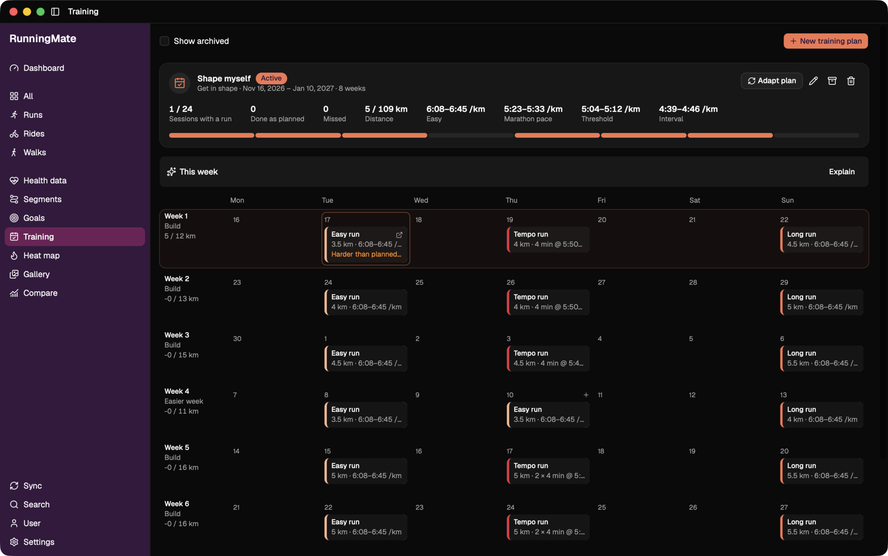

# Training

A training plan gets you to a target over a number of weeks: a race (5 km, 10 km, half marathon, marathon or any other
distance, with an optional target time), getting in shape, or more fitness. The plan is built from fixed rules modelled
on common running plans (Daniels, Pfitzinger, Higdon), starting from your runs of the last 6 months. Plans are for
running only: rides and walks don't count.

## Making a plan
Open the **Training** page from the sidebar or with ⇧⌘T and click **New training plan**. The wizard has three steps.

1. **Training for**: **A race**, **Get in shape** (mostly easy runs and one faster run a week) or **More fitness**
   (intervals and tempo runs). For a race, pick the **Distance**: 5 km, 10 km, **Half marathon**, **Marathon** or
   **Other distance** (1 to 100 km). **Target time (optional)**, as H:MM:SS, sets the race pace; without it the pace
   comes from your runs.
2. **Start**, **Weeks**, **Training days** and **Long run**: the first day (the next Monday unless you change it), the
   number of weeks (4, 6, 8, **3 months**, 16, or any number from 1 to 52), the weekdays you can train and the day of
   the long run, one of your training days. A race is on the long-run day of the last week. **Name** is optional; left
   empty, the plan is named after its target, for example "10 km in 0:45:00".
3. Preview: **Your last 6 months** shows what the plan starts from (km a week lately, runs a week, longest run,
   VO2max), then the number of sessions, the end date, your easy and threshold paces, and the plan week by week with
   its phase, its km and a bar per session. Warnings show up above it:
    - the plan is shorter than usual for the distance (4 weeks for up to 6 km, 6 for up to 12 km, 8 for up to 25 km,
      12 beyond);
    - you ran less than half of what the distance usually builds on (10, 15, 20 or 30 km a week); the plan starts
      gently;
    - there are too few runs to work out paces, so the sessions only have distances;
    - the target time needs a VO2max more than 5 above your current one; training starts from where you are.

    Tick **Also set a goal** to create a matching goal on the [Goals](goals.md) page: for a race, the race distance in
    one run by the race day (within the target time, if you gave one); otherwise the plan's average weekly km every
    week until the plan ends.

Click **Create plan** to save it.

## How plans are built
The plan is worked out from your runs by fixed rules, so the preview in the wizard is the plan you get. No AI is
involved.

### Where it starts
- **Volume**: the km you ran per week over the last 8 weeks, or 80 % of your weekly km over the last 26 weeks when that
  is more, and at least 10 km.
- **Longest run**: the longest run of the last 8 weeks (of the last 26 when there was none), and at least 5 km.
- **VO2max**: the higher of the estimate from your whole runs and the one from your fastest stretch of 3 km or more
  (a best effort) in the last 26 weeks. Without either, the VO2max from your [profile](user-settings.md) is used.
  With a target time, training paces come from the lower of your current VO2max and the one the target time needs.

### Phases
- A race plan ends with a *Taper*: one week for races up to 12 km, two for longer ones. The weeks before it are split
  into *Base* (about 40 %), *Build* (about 40 %) and *Peak* (about 20 %).
- Get in shape and More fitness plans have three building weeks and an *Easier week*, again and again.

### Weekly volume
- The km grow by at most 10 % a week, up to a peak: 1.5 times the starting volume (1.3 times for Get in shape), and
  never more than 35 km a week for races up to 6 km, 45 km up to 12 km, 55 km up to 25 km and 70 km beyond.
- Every fourth week is easier, at 75 % of the week before. Building goes on from where it left off afterwards.
- The taper cuts the km: one taper week to 60 %; two taper weeks to 75 % and then 55 %.

### Sessions
- **Long run**, at easy pace on the long-run day: about 30 % of the week's km (35 % for a half marathon, 42 % for a
  marathon, 5 points more with three training days or fewer). It grows by at most 2 km a week over your longest run so
  far and stops at 14 km for races up to 6 km, 17 km up to 12 km, 21 km up to 25 km, 32 km beyond, 16 km for Get in
  shape and 18 km for More fitness. It is always the longest session of the week.
- **Hard sessions** (**Tempo run** or **Intervals**): none with one training day, one with two or three days, two with
  four or more. Base and taper weeks and all Get in shape weeks have at most one, easier weeks none. They go on the
  days farthest from the long run, never the day before or after it or another hard session. Each has a warm-up and
  cool-down of a quarter of the week's km (2 to 3.5 km), and its work stays within 20 % of the week's km and shorter
  than the long run; repetitions are cut to fit.
- **Easy runs** share the rest of the week's km, at least 3 km each; when there isn't enough for all training days,
  some days stay free. The run on the day after the long run is a **Recovery run**, 80 % as long and a little slower.
- **Race week**: up to three short recovery runs (3 to 6 km) before the race, not on the day before, then the
  **Race** on the long-run day. Nothing after it.

Hard sessions get longer through each phase:

| Plan and week          | First hard session                     | Second hard session                          |
|------------------------|----------------------------------------|----------------------------------------------|
| Get in shape           | 3 to 5 × 4 min at threshold pace       | –                                            |
| More fitness           | 5 to 8 × 800 m at interval pace        | 2 to 3 × 10 min at threshold pace            |
| Race, base             | 2 to 3 × 8 to 10 min at threshold pace | –                                            |
| Race, build            | 3 to 4 × 10 min at threshold pace      | 5 to 6 × 1 km at interval pace¹              |
| Race, peak             | 4 to 5 × 1600 m at race pace¹          | 20 min at threshold pace                     |
| Race, taper            | 4 × 1 km at race pace¹                 | –                                            |

¹ For races over 12 km: build 2 to 3 × 3 km at marathon pace, peak 2 to 3 × 4 km at race pace, taper 3 × 2 km at race
pace. The rest between repetitions is 2 minutes, 3 for 1 km, 1600 m and 2 km repetitions.

### Paces
Paces come from your VO2max after Jack Daniels' tables, each a range in min/km:

- **Easy**: 62 to 70 % of VO2max, for easy and long runs. Recovery runs go from 10 s/km faster to 20 s/km slower than
  the slow end of easy pace.
- **Marathon pace**: your predicted marathon pace, ±5 s/km.
- **Threshold**: 86 to 89 % of VO2max, for tempo runs.
- **Interval**: 96 to 99 % of VO2max.
- **Race pace**: the target time divided by the distance, or else the time predicted from your VO2max, ±3 s/km.

Without a VO2max and without a target time, sessions only have distances.

## Following the plan

The Training page shows the selected plan with its state (**Upcoming**, **Active** or **Finished**), its target and
dates, the badge of its matching goal, and **Sessions with a run**, **Done as planned**, **Missed**, the **Distance**
done and planned, and your paces. A coloured strip shows the phases. With several plans, pick one from the row at the
top; **Show archived** includes archived plans.

Below come the plan's weeks as rows of seven days, with the phase and the km done and planned per week, the current
week highlighted, and a card per session with what it asks for and, once done or past, how it went. Click a session to
change its **Kind**, **Date**, **Distance**, **Pace** (fastest and slowest), and for tempo runs and intervals the
**Repetitions**, **Minutes each** or **Metres each** and **Rest (s)**, or to add a **Note**. **Skip** marks it as
skipped (**Not skipped** undoes it), and the bin deletes it. Hover a day and click **+** to add a session.

**Adapt plan** rebuilds the sessions from today on from your recent runs. It goes on with 1.1 times your weekly km of
the last 3 weeks (at least 10 km), never with more than the plan had for this week, and from your current longest run
and VO2max. Sessions before today stay, and so do sessions you changed, skipped, linked to a run or set to have no
run. It isn't available once a plan is finished.

From the plan's buttons you can also **Rename**, **Archive** (**Restore**) or delete a plan. Deleting removes the plan
and its sessions; your runs and a matching goal stay.

The dashboard shows the sessions of this week and next week in a row below the goals; click one to open the Training
page. In the four-week calendar, days with a session get a ring: dashed in the session's colour while ahead, in the
colour of how it went once done or past. Both move with the dashboard's date arrows.

## Matching runs to sessions
Every run is matched to a session automatically: a run on the session's day first, otherwise one on the day before or
after that no other session took; between two runs, the one closer to the planned distance. In the session window,
under **Run**, you can link another run from the three days either side by hand, choose **No run for this session**,
or go back with **Match automatically**. An activity that did a session shows a small calendar mark in the dashboard
feed and the activity panel, in the colour of how it went; hover it for the plan, the kind of session and the result.

Each session gets a verdict:

- **Done as planned**: at least 80 % of the planned distance, and not harder or easier than planned. A race counts as
  done from 97 % of its distance, as GPS measures a little short.
- **Harder than planned**: an easy, recovery or long run more than 10 s/km faster than easy pace, an easy or recovery
  run more than 30 % longer than planned, or an average heart rate above zone 2 (once your heart-rate zones are saved
  in the profile).
- **Easier than planned**: the fastest kilometres of a tempo or interval run (as many as its work) more than 15 s/km
  slower than the slow end of its pace.
- **Partly done**: less than 80 % of the planned distance.
- **Missed**: a past session without a run that wasn't skipped.
- **Skipped**: a session you skipped.

The pace of a run is its moving pace, without pauses. Matching is worked out from your runs each time, so importing,
editing or deleting a run updates it right away.

## AI coach
With AI turned on in the settings (a local Ollama model), the Training page has a **This week** note: **Explain** has
the model explain the current week of the plan. In the session window, once a run did the session, **Comment** has it
comment on how the run went. **Rewrite** writes a note again. Notes are kept and marked with the model that wrote
them. The plan doesn't need it: without a model these notes are just not shown.
