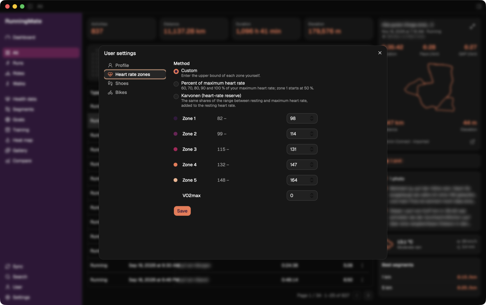

# User Settings

The user settings hold your profile, your heart-rate zones and your shoes and bikes. Open them with **User** at the
bottom of the sidebar or with **RunningMate → User Profile…**. Pick a page on the left. **Heart rate zones**, **Shoes**
and **Bikes** become available once you have saved a profile.

## Profile
Fill in the fields and click **Save**.

- **Name**
- **Birthday**, as DD.MM.YYYY. Your age is calculated from it, for the suggested heart-rate zones and for rating your
  cardio fitness.
- **Weight (kg)**, between 20 and 300. Used for the calories and the power estimate of each activity.
- **Height (cm)**, between 100 and 250.
- **Resting heart rate (bpm)**, between 30 and 120. Used for the heart-rate zones with the Karvonen method.
- **Maximum heart rate (bpm)**, between 100 and 230 and above the resting heart rate. Used for the suggested
  heart-rate zones and the zones worked out from it.
- **Sex**, optional. Only used to compare your cardio fitness (VO2max) with people of your age and sex.

A changed weight applies to activities imported or recomputed afterwards.

## Heart rate zones
First pick how the five zones are set under **Method**:

- **Custom**: you enter the upper bound of each zone in bpm. The lower bound of each zone is shown next to it: zone 1
  starts at half the upper bound of zone 5, every other zone one beat above the previous one. Each bound must be a
  whole number between 40 and 240 and above the previous one. As long as you haven't saved bounds, the page suggests
  some: 60, 70, 80, 90 and 100 % of your maximum heart rate, or of 220 minus your age if you haven't entered one.
  Adjust them and click **Save**.
- **Percent of maximum heart rate**: the zones end at 60, 70, 80, 90 and 100 % of the maximum heart rate from your
  profile; zone 1 starts at 50 %.
- **Karvonen (heart-rate reserve)**: the same shares, but of the range between your resting and maximum heart rate,
  added to the resting heart rate.

For the last two the page shows the resulting zones in bpm; you can't edit them. They follow your profile: change
your resting or maximum heart rate there and the zones change with it. Without a maximum heart rate (and, for
Karvonen, a resting heart rate) in the profile the page asks you to enter them and you can't save the method. Your
custom bounds are kept when you switch to another method, so switching back brings them back.

Until zones are saved, no time in zones is shown. With zones, you see **Time in heart-rate zones** on the **Heart
rate zones** page of the [detail window](detail-window.md) and on the Health Data page. In the **Heart-rate trend**
on that page, the tops of zones 1, 3 and 5 are drawn as **Min**, **Ideal** and **Max** lines.
See [Heart rate zones](../metrics/heart-rate-zones.md) for the methods and how the time in zones is worked out.

**VO2max** is your own value, if you know it (for example from a lab test or your watch). It is used where RunningMate
can't estimate one from your runs.

## Shoes and Bikes
Shoes are for runs and walks, bikes for rides. Each page lists your items with their **Distance (km)** and an
**In use** switch.

- Add an item with a name (and, for a bike, an optional **Weight (kg)**) and click **Add**. It starts at 0 km.
- Assign it to an activity on the **Edit** page of the [detail window](detail-window.md), under **Shoes** or **Bike**.
  New activities get none; you pick it per activity. The change applies right away and moves the activity's distance
  from the previous item to the new one.
- The distance follows the activities: editing an activity's distance, re-importing it or deleting it adds or takes
  off the difference.
- Switch **In use** off for shoes or bikes you've retired. They keep their distance but aren't offered for new
  activities.
- Deleting an item removes it from every activity it was assigned to. To keep the history, switch **In use** off
  instead.
